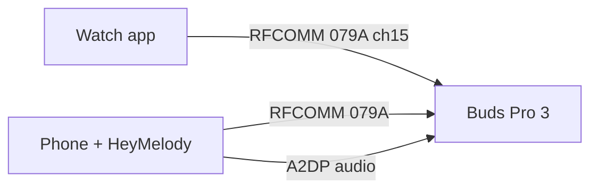

# Hey Melody Watch: noise control for OnePlus Buds Pro 3 on Galaxy Watch 8

Scope: one feature. Read and set the noise-control mode (Off / Transparency / ANC + ANC level) of OnePlus Buds Pro 3 from a Galaxy Watch 8. Nothing else (no EQ, gestures, battery beyond what is free).

## 0. Existing app: try it first

**WearEars** (https://github.com/hdzw1155/WearEars, MIT, Wear OS 3+, last release v0.4.2 on 2026-11-18, debug APK in Releases).
- Runs on the watch, talks to the buds directly over RFCOMM. The phone is not involved. Author tests on a Galaxy Watch7.
- Its OPPO/OnePlus driver (`oppo/OppoOpoClient.java`) matches any Bluetooth name containing `oneplus`, so Buds Pro 3 will be picked up.
- Verified models: OPPO Enco Air5 Pro, Enco Free4. **Buds Pro 3: not verified.**
- Gaps for Buds Pro 3, read from source `[INFERENCE, not run]`:
  - Only 3 states: Off / ANC / Transparency. No level choice (Smart, Deep, Medium, Light).
  - `OppoProtocol.noiseMode()` treats only report bits `0x02` and `0x10` as ANC. Buds Pro 3 report Medium `0x20`, Light `0x40`, Smart `0x80`, so the current mode shows as unknown when ANC is on at those levels. Deep (`0x10`) displays correctly.
  - Writing still works: it sends `0x0404 01 01 02`, which is ANC at the last-used level.

Test it: `adb install -r wearears-debug.apk` to the watch (wireless debugging, section 6). If it is good enough, stop here, or send it a ~10-line PR adding the levels.

## 1. Requirements

| Item | Detail |
|---|---|
| Watch | Galaxy Watch 8, Wear OS 6 (Android 16, API 36) `[INFERENCE: shipping OS of the Watch 8]` |
| Buds | OnePlus Buds Pro 3, product id `064014`; supports dual connection |
| Pairing | Buds must be paired **to the watch** (Settings → Connections → Bluetooth), while staying connected to the phone. Uses one of the buds' two dual-connection slots. |
| Transport | Bluetooth Classic RFCOMM/SPP, not BLE. Service UUID `0000079A-D102-11E1-9B23-00025B00A5A5`, RFCOMM channel 15 |
| Android permission | `BLUETOOTH_CONNECT` (runtime, API 31+). No location, no scan: we use the bonded-device list |
| Toolchain (present on this machine) | JDK 17 (mise), Gradle, Android SDK at `~/Android/Sdk`, `adb` |
| Language/UI | Kotlin, Jetpack Compose for Wear OS (`androidx.wear.compose:compose-material3`), Tiles (`androidx.wear.tiles` + ProtoLayout) |
| minSdk / targetSdk | 30 (Wear OS 3) / 36 |

## 2. Architecture decision: watch talks to the buds directly



Rejected alternative: watch → Wearable Data Layer → phone companion app → buds. The phone already has HeyMelody, and the buds/Android allow only one holder of the `079A` channel per phone (QuickBuds PROTOCOL.md §1). A phone bridge would fight HeyMelody for the socket, and needs a second app.

Direct link risk: whether the Buds Pro 3 `079A` server accepts a second link (watch) while the phone holds one. Nord Buds 4 Pro firmware takes 2 links; Pro 3 is unconfirmed. This is the first spike (section 5, step 1).

## 3. Protocol subset (ANC only)

Sources: QuickBuds `docs/PROTOCOL.md` §2, §6, §10, §14 and `assets/models.json` entry `064014` (HeyMelody's own mode table); nic0manz/oneplus_buds3_pro_python (packets confirmed on Buds Pro 3). Both agree on the bits below.

### Frame
```
AA <TotalLen> 00 00 <Cmd LE u16> <Seq> <PayLen LE u16> <Payload>
```
- `TotalLen` = 7 + PayLen, LEB128 (one byte for anything we send).
- Reply cmd = request cmd | `0x8000`, echoes `Seq`. Pushes from the buds use `Seq = FF`.
- Writes reply with a status byte: `00` accepted (not proof; read back), `0E` = no bud in an ear.
- No checksum. Read as a byte stream: drop bytes before `AA`, read length, wait for the full frame. Ignore slice frames (byte 2 != `00`); ANC traffic never uses them.

### Messages
| Step | Send | Expect |
|---|---|---|
| Handshake | `0x0100`, empty payload: `AA 07 00 00 00 01 <seq> 00 00` | `0x8100` + command bitmap |
| Subscribe to ANC pushes | `0x0205 01 03` (count 1, code `03`) | `0x8205` ack |
| Read mode | `0x010C 01 01` | `0x810C 00 01 01 <mask LE>` |
| Set mode | `0x0404 01 01 <mask>` | `0x8404 <status>`, then push `0x0204 03 01 01 <mask>` |
| Smart's chosen level | (push) | `0x0204 03 04 01 <mask>` |
| Hold-cycle change | (push) | `0x0204 03 02 <kind> <mask>`: not a mode, ignore |

### Buds Pro 3 mode bits
SET bits (what we write) differ from REPORT bits (what the buds answer).

| Mode | SET payload | REPORT mask |
|---|---|---|
| Off | `01 01 01` | `0x0008` |
| ANC, last level | `01 01 02` | level bit, or `0x0002` |
| Transparency | `01 01 04` | `0x0100` |
| ANC Deep | `01 01 10` | `0x0010` |
| ANC Medium | `01 01 20` | `0x0020` |
| ANC Light | `01 01 40` | `0x0040` |
| ANC Smart | `01 01 80` | `0x0080` (+ `03 04 01` push naming the level it picked) |

No Adaptive (`0x0800`) on Buds Pro 3. Decode the report by lowest set bit; never by equality.

## 4. App design

One Gradle module, `:app` (`dev.flashblaze.heymelodywatch`). Reference implementation read: WearEars `oppo/OppoOpoClient.java` (cloned at `~/Projects/WearEars`).

| File | Role |
|---|---|
| `protocol/Frame.kt` | `Frame.encode()`, streaming `Framer` (resyncs on `AA`, skips slices, rejects bad headers early) |
| `protocol/Anc.kt` | `NoiseMode`, `AncLevel`, `NoiseState`: SET bits and REPORT-bit decoding for `064014` |
| `protocol/Messages.kt` | Command ids, payload builders, `Decode.anc()` for `0x810C` replies and `0x0204` pushes |
| `BudsLink.kt` | One RFCOMM session: connect order `079A` secure → insecure → channel 15, 12 s timeout, reader thread, `request()` matched on (cmd\|0x8000, seq) |
| `Buds.kt` | Process singleton shared by app and tile. `acquire()`/`release()` refcount; socket closes 5 s after the last release. Handshake → `0x0200` offered events → `0x0205` subscribe (or `0x0201` per code) → read mode. Up to 3 reconnects on a drop. `setMode()` sends SET, maps status (`0E` = not worn), reads back. Last reported mode kept in SharedPreferences for the tile |
| `MainActivity.kt` | Compose for Wear: header, Noise cancelling / Transparency / Off radios, ANC level radios (Smart shows its pick), buds picker, permission / Bluetooth-off / not-paired / failed screens |
| `NoiseTileService.kt` | Off / ANC / Trans buttons as `LoadAction`s; `onTileRequest` runs a session, sets, reads back, redraws. Title opens the app |

Out of scope: battery, EQ, gestures, phone app, Play Store release.

## 5. Build order

1. ✅ Protocol code + JVM unit tests (`./gradlew :app:testDebugUnitTest`).
2. ✅ `BudsLink` / `Buds` session.
3. ✅ Compose screen.
4. ✅ Tile.
5. **On the watch, first run = the spike:** install, open the app with the buds connected to phone and watch, read `adb logcat -s BudsLink`. Expect `connected via secure 079A`, then `rx cmd=8100`. If connect fails, retry with HeyMelody force-stopped on the phone.
6. Real-device checks: every mode in the table, a mode changed by holding the bud stem shows up on the watch (push), both buds in case → "Put a bud in your ear first", case closed → reconnect/fail, tile taps, battery drain over a day with the app idle.

## 6. Dev loop on the watch

1. Watch: Settings → About watch → Software → tap Software version 5× → Developer options → ADB debugging + Wireless debugging on.
2. Laptop on the same Wi-Fi: `adb pair <ip>:<pair-port>` (code on the watch), then `adb connect <ip>:<port>`.
3. `./gradlew :app:installDebug`, logs with `adb logcat -s BudsLink`.
4. The emulator has no Bluetooth Classic to real buds; all link testing is on the physical watch.

## 7. Risks

| Risk | Mitigation |
|---|---|
| Buds refuse a 2nd `079A` link while phone holds one | Spike step 1. Fallback: close HeyMelody (force-stop) during tests; if still refused, phone bridge via Data Layer with our own phone app replacing HeyMelody (QuickBuds is GPL-3.0 if reused) |
| Watch steals audio when buds connect to it | Watch only plays its own media through them; check Galaxy Watch "audio output" setting; RFCOMM itself does not route audio |
| Third dual-connection device (laptop) | Buds hold 2 devices; watch takes a slot |
| Firmware update changes bits | Read back after every write; show reported state, never assumed state |
| Galaxy Watch kills background sockets | No background link; connect on demand |
| License | WearEars MIT (reuse fine). QuickBuds GPL-3.0: use as a spec only, write our own code, or release ours as GPL |
