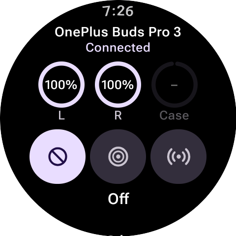
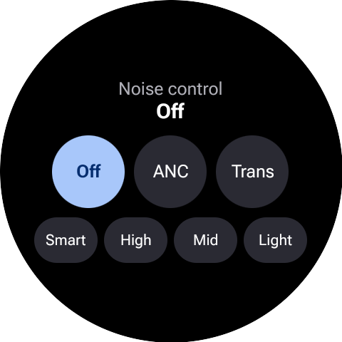
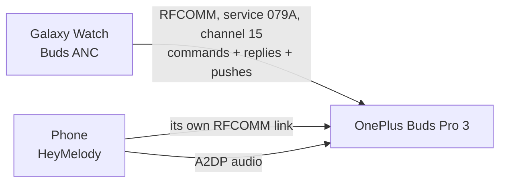
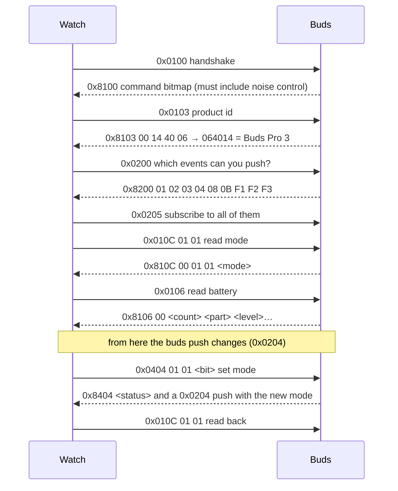

# Hey Melody Watch

A Wear OS app that controls the noise cancelling of **OnePlus Buds Pro 3** straight from a **Galaxy Watch 8**, and shows the battery of both buds and the case. No phone app is involved: the watch talks to the buds over Bluetooth itself, while the phone keeps playing audio to them.

<p>
  
  
</p>

Unofficial. Not affiliated with OnePlus, OPPO or HeyMelody.

## Features

- **Noise control modes:** Off, Noise cancelling, Transparency.
- **ANC levels:** Smart, High, Medium, Light. Picking a level turns noise cancelling on at it. In Smart mode the screen shows the level the buds picked ("Using Medium"); Smart cannot be told which level to use.
- **Battery:** left bud, right bud and case, with charging state. Readings the buds stopped sending (case lid shut) or from before a disconnect are shown dimmed.
- **Tile:** Off / ANC / Trans and the four levels, one tap each.
- **Live state:** a mode changed by holding a bud's stem appears on the watch right away.
- **Honest display:** the app shows what the buds report, never what it asked for. Every change is read back.
- **Battery-friendly:** the Bluetooth link is open only while the app or tile is in use.

## Setup

1. **Pair the buds with the watch:** on the watch, Settings › Connections › Bluetooth, with the buds in pairing mode. They stay connected to the phone too (they support two devices at once).
2. **Install the app:** turn on Developer options on the watch (Settings › About watch › Software › tap *Software version* 5×), then *ADB debugging* and *Wireless debugging*. From a computer on the same Wi-Fi:

   ```sh
   adb pair <watch-ip>:<pairing-port>     # code shown on the watch
   adb connect <watch-ip>:<port>
   ./gradlew :app:installDebug
   ```

3. Open **Buds ANC** on the watch and allow *Nearby devices*.
4. Optional: add the **Noise control** tile from the tile list.

The app picks the first paired device named "OnePlus Buds"; *Choose buds* at the bottom of the screen selects another paired headset.

## How it works

### The link

OnePlus and OPPO earbuds take app commands over a **Bluetooth Classic serial link (RFCOMM/SPP)**, not BLE. HeyMelody on the phone uses the same service. The watch opens its own link to the buds, so the phone and HeyMelody are left alone.



- Service UUID `0000079A-D102-11E1-9B23-00025B00A5A5`, RFCOMM channel 15 on the Buds Pro 3.
- Connect order: that UUID with a secure socket, then insecure, then channel 15 directly. Each try gives up after 12 s.
- The buds accept a link from the watch while the phone holds its own.

### Frames

Every message, in both directions, is one frame. There is no checksum.

```
AA <TotalLen> 00 00 <Cmd u16 LE> <Seq> <PayLen u16 LE> <Payload>
```

| Field | Meaning |
|---|---|
| `AA` | Frame start |
| TotalLen | Bytes after this field, LEB128 (one byte below 128). Whole message: `7 + PayLen` |
| `00 00` | Whole message (not a slice) |
| Cmd | Command id. A reply carries `Cmd | 0x8000` |
| Seq | Chosen by the sender; the reply echoes it, which is how a reply is matched to its request |
| Payload | Command-specific |

Example, set noise control Off: `AA 0A 00 00 04 04 06 03 00 01 01 01`.

The reader treats the socket as a byte stream: it drops bytes before `AA`, waits for the whole frame, and rejects a header whose lengths don't add up (so a stray `AA` cannot stall it).

### Session



Messages go out 200 ms apart, as HeyMelody paces them. Without the subscription the buds stay silent about changes made on the buds.

### Noise control

The bit you **set** is not the bit the buds **report**. A report is decoded by its lowest set bit.

| Mode | Set payload (`0x0404`) | Reported mask |
|---|---|---|
| Off | `01 01 01` | `0x0008` |
| Noise cancelling, last level | `01 01 02` | the level's bit |
| Transparency | `01 01 04` | `0x0100` |
| High | `01 01 10` | `0x0010` |
| Medium | `01 01 20` | `0x0020` |
| Light | `01 01 40` | `0x0040` |
| Smart | `01 01 80` | `0x0080` |

- **Smart** picks a level itself and reports it separately: push `03 04 01 <mask>` or read `0x010C 04 01`, in the set bits above. There is no command to choose Smart's level.
- **Which levels a model has** is not something the buds list. HeyMelody keeps a table per product id; this app knows `064014` (Buds Pro 3). Other models get Off / ANC / Transparency only, because a wrong bit silently sets another mode.
- **Reply status** of `0x8404`: `00` accepted, `0E` no bud in an ear ("Put a bud in your ear first"), anything else refused. Accepted does not prove applied, so the app always reads the mode back.
- A push `03 02 …` is the stem-hold cycle setting, not a mode, and is ignored.

### Battery

Read `0x0106` → `00 <count> (<part> <raw>)…`; push `01 <count> (<part> <raw>)…`.

- Part: `1` left, `2` right, `3` case.
- Raw: level = `raw & 0x7F`, bit 7 = charging, `FF` = unknown. `E4` is 100% and charging.
- The case is only reported while its lid is open. A part missing from a report keeps its last level, dimmed. The last readings are saved for the next launch.

### Connection lifecycle

`Buds` is one shared connection for the app screen and the tile.

- The screen holds it from `onStart` to `onStop`; a tile tap holds it for one action. The socket closes 5 s after the last user lets go, so the watch never keeps a link open in the background.
- If the buds drop the link (case closed, out of range) the app reconnects up to 3 times, 2 s apart, then shows *Retry*.
- While connecting, the screen shows the last known mode and battery, dimmed, with the controls disabled.

### Tile

Each tile button is a `LoadAction` with an id like `set:HIGH`. The system calls `onTileRequest` with that id; the service connects, sets the mode, reads it back and returns the redrawn tile. Tapping the title opens the app.

## Code map

```
app/src/main/java/dev/flashblaze/heymelodywatch/
├── protocol/
│   ├── Frame.kt          frame encoding, streaming Framer
│   ├── Anc.kt            modes, levels, set/report bits, per-model level table
│   └── Messages.kt       command ids, payload builders, reply/push decoders
├── BudsLink.kt           one RFCOMM session: connect, reader thread, request/reply matching
├── Buds.kt               shared connection: lifecycle, session setup, state, saved readings
├── MainActivity.kt       Compose for Wear screen
├── NoiseTileService.kt   tile
└── Labels.kt             display names
app/src/test/.../ProtocolTest.kt   protocol tests on captured bytes
```

## Build, test, debug

Requires JDK 17+, Android SDK (compileSdk 37).

```sh
./gradlew :app:testDebugUnitTest   # protocol tests, no device needed
./gradlew :app:installDebug        # build and install on the connected watch
adb logcat -s BudsLink             # every frame sent and received, in hex
```

The emulator has no Bluetooth Classic link to real buds, so anything beyond the unit tests needs the watch.

## Limitations

- Levels are known for the Buds Pro 3 only. Other OnePlus/OPPO models connect with Off / ANC / Transparency.
- The buds must be paired with the watch, not just the phone.
- Mode changes need at least one bud in an ear; the buds refuse them otherwise.
- The case battery is unknown while its lid is closed.

## Credits

The protocol comes from public reverse-engineering work; no code was copied from it:

- [QuickBuds](https://github.com/spizganed/QuickBuds) `docs/PROTOCOL.md` and its model table: frame format, init sequence, mode bits, battery.
- [nic0manz/oneplus_buds3_pro_python](https://github.com/nic0manz/oneplus_buds3_pro_python): Buds Pro 3 command bytes.
- [WearEars](https://github.com/hdzw1155/WearEars): proof that a Wear OS watch can drive these buds directly, and its connect order.

Research notes and design decisions: [PLAN.md](PLAN.md).
